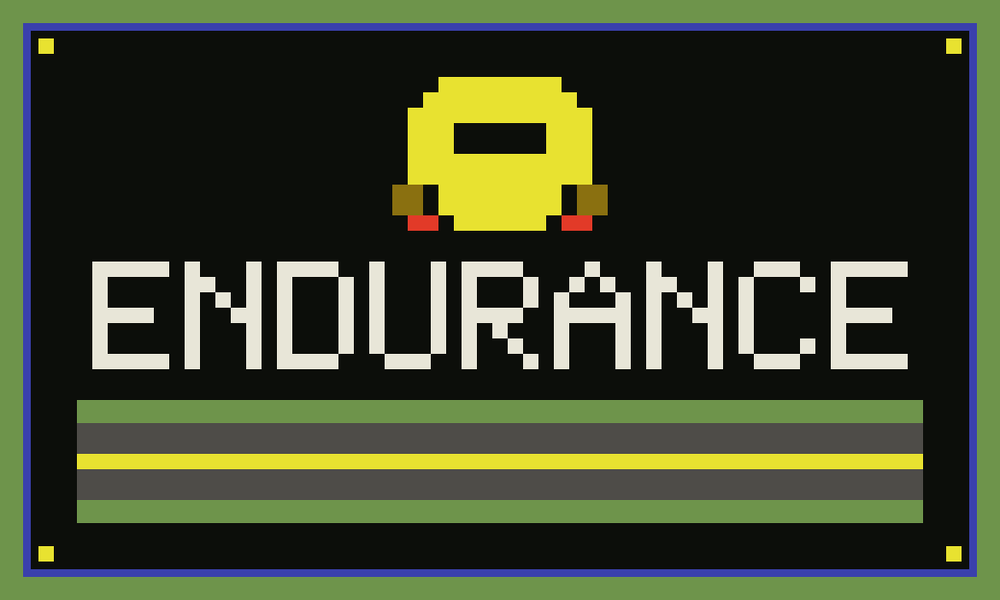
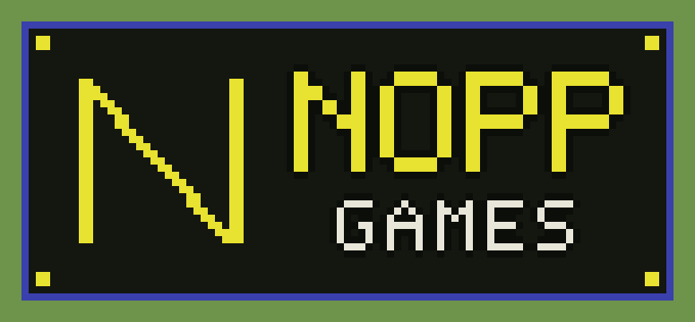

  

  A browser endurance racer, in the spirit of the 1983 original. 
  Original pixel art and road. Not the Activision cartridge. 

## How to play

The race starts from a standstill, at dawn. Hold the gas to build speed. Let go, and the car holds that speed. Brake by pulling back. Each car you pass takes one off the counter. If they pass you, the number goes up.

Day 1 is 50 cars before dawn. From day 2 on, 55. If the counter is still above zero at daybreak, the race is over. The dash shows the miles and the day. That is the score.

| Key | Action |
| --- | --- |
| `←` `→` or `A` `D` | Steer |
| `Space`, `↑`, `Z`, or `X` | Gas (hold) |
| `↓` or `S` | Brake |
| `Enter` | Start |
| `P` | Pause |
| `M` | Mute or unmute |

On a phone, the buttons sit on the screen. Holding a finger on the canvas also gives gas and steers toward that side. A gamepad works too: the pad steers, down brakes, a button is gas.

The day runs through dawn, open road, ice, dusk, night, and fog. On ice the steering is slow to answer. At night you only see taillights. In the fog, cars appear close. A crash dumps your speed and costs several places. Leaving the road costs less than a crash.

Five days in one race shows the Roadbuster trophy. The best day and mileage stay saved in this browser.

The sound is the engine, with four automatic gears: the note climbs inside a gear, drops on the shift, and holds in fourth. Ice, the shoulder, a crash, the flags, and daybreak each have their own sound.

## Files

`index.html` is the page. `css/style.css` is the look. `js/game.js` is the game. `assets/` holds the logos.

Opening `index.html` from disk is enough. There is no room and no multiplayer.

  

